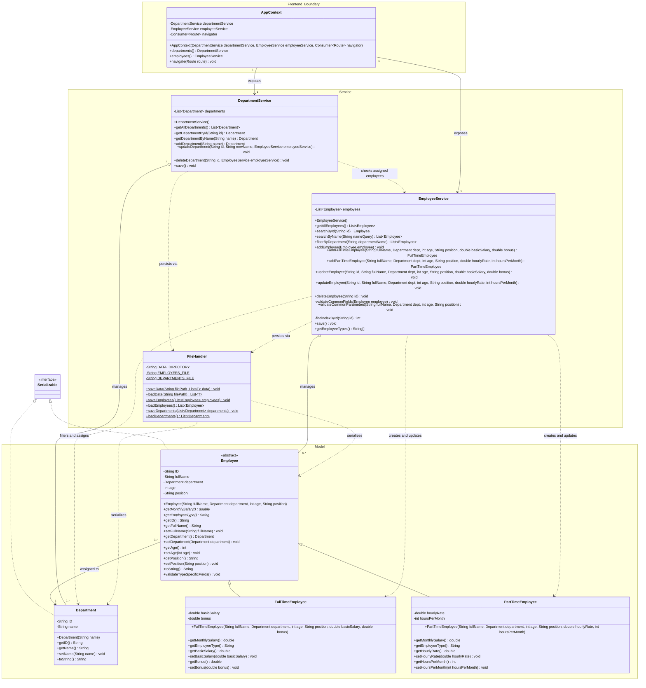
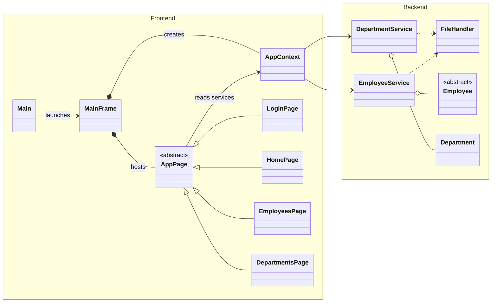

# Preliminary UML Class Diagram — Backend (`Model` and `Service`)

This file separates the Employee Management System (EMS) into two layers:

1. **Backend (detailed now):** `Model` and `Service`, plus the `AppContext` boundary from the frontend.
2. **Frontend (placeholder):** high-level `UI` packages to expand in the next step.

## 1. Backend Class Diagram

## 2. Frontend vs Backend Split (Preliminary Placeholder)

## 3. Code vs Lab 7 Notes

- `Employee.ID` and `Department.ID` use UUID `String` values in the current code. Lab 7 Section 4.1 specifies an integer employee ID.
- `Employee.validateTypeSpecificFields()` is currently an empty method in `Employee` and has no overrides in `FullTimeEmployee` or `PartTimeEmployee`.
- `EmployeeService.searchById(String id)` compares strings with `==` instead of `.equals(...)`.
