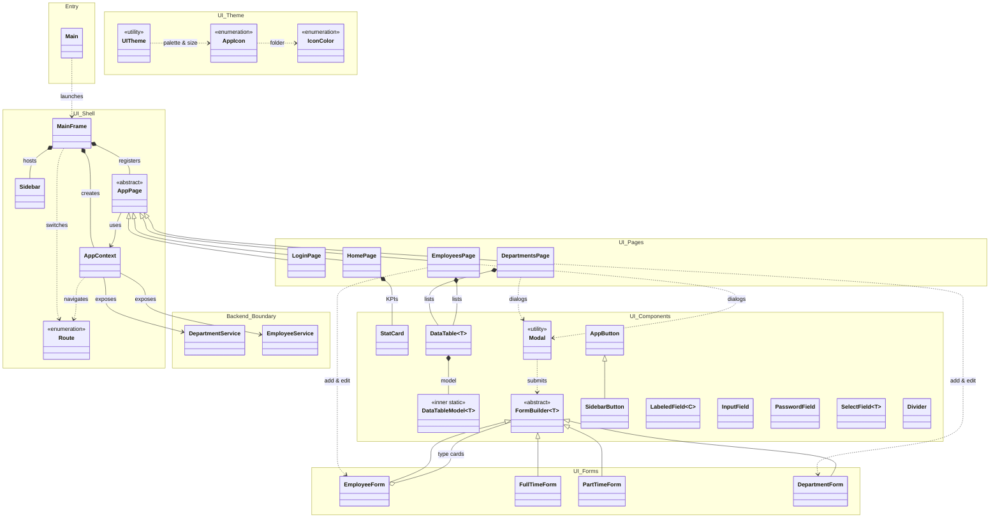
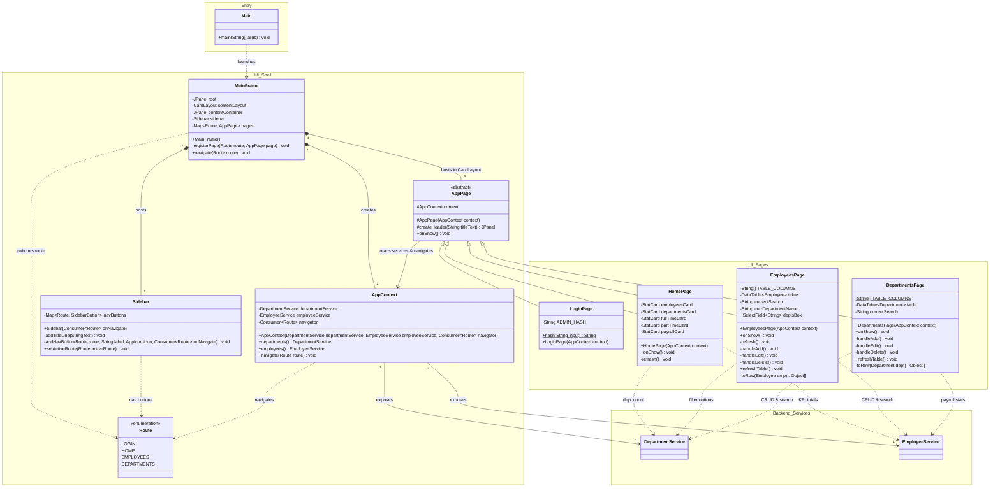
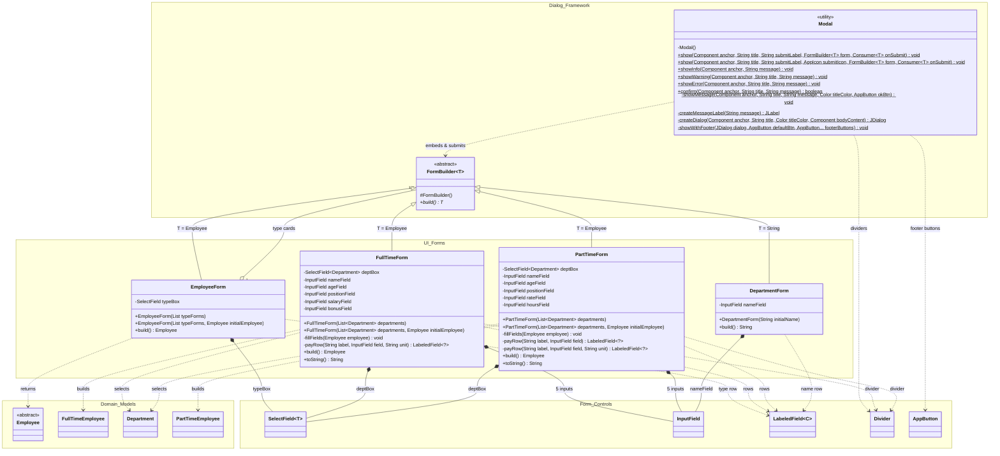
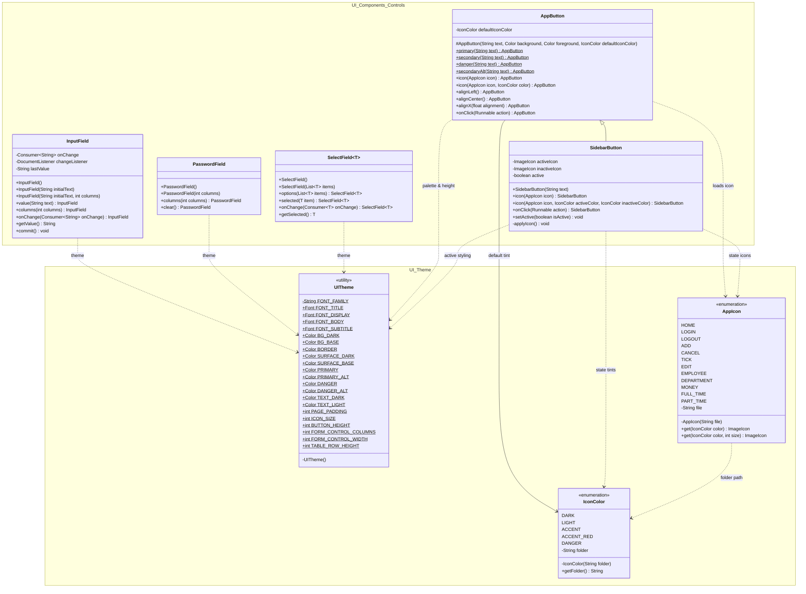
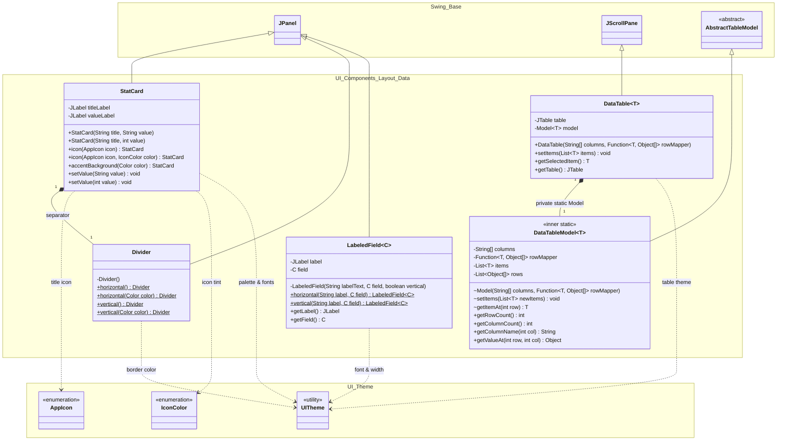

# UML Class Diagram — Frontend (`Main` and `UI`)

This document complements [backend-class-diagram.md](backend-class-diagram.md) with the complete Employee Management System (EMS) frontend (`Main` and all `UI.*` packages).

To keep every diagram readable with zero overlapping boxes, zero hidden elements, and no tangled cross-cutting lines, the frontend is organized into five focused views:

1. **Full Frontend Architecture Overview:** All 28 frontend classes (plus inner class `DataTable.Model` and backend services) grouped cleanly by package.
2. **Shell & Pages (`Main`, `UI.Shell`, `UI.Pages`):** Application startup, routing, sidebar navigation, and all four pages in full detail.
3. **Forms & Modals (`UI.Forms`, `FormBuilder`, `Modal`):** Modal dialog framework, abstract form base, and all employee/department forms in full detail.
4. **Reusable Components & Theme (`UI.Components`, `UI.Theme`):**
   - **4A. Interactive Controls & Theme:** Buttons, text/password/select inputs, icons, and theme tokens.
   - **4B. Layout, Table & Display Components:** `LabeledField`, `DataTable` + `DataTable.Model`, `StatCard`, and `Divider`.
5. **Swing Superclass Mapping & Design Notes:** Complete `javax.swing` inheritance table and architectural observations.

---

## 1. Full Frontend Architecture Overview

> High-level package & class overview. Detailed fields, methods, `UITheme` references, and widget-level edges are shown in Sections 2–5 so this overview remains compact and readable.

---

## 2. Shell & Pages — Detailed Class Diagram (`Main`, `UI.Shell`, `UI.Pages`)

---

## 3. Forms & Modals — Detailed Class Diagram (`UI.Forms`, `FormBuilder`, `Modal`)

---

## 4. Reusable Components & Theme — Detailed Class Diagrams (`UI.Components`, `UI.Theme`)

### 4A. Interactive Controls & Theme

### 4B. Layout, Table & Display Components

---

## 5. Swing Superclass Mapping & Frontend Design Notes

### Java Swing Superclass Summary

| Package | Class | Superclass / Kind |
| :--- | :--- | :--- |
| `(default)` | `Main` | Standalone entry point |
| `UI.Shell` | `MainFrame` | `extends JFrame` |
| `UI.Shell` | `Sidebar` | `extends JPanel` |
| `UI.Shell` | `AppPage` | `abstract class extends JPanel` |
| `UI.Shell` | `AppContext` | Standalone context holder |
| `UI.Shell` | `Route` | `enum` |
| `UI.Pages` | `LoginPage`, `HomePage`, `EmployeesPage`, `DepartmentsPage` | `extends AppPage` (`JPanel`) |
| `UI.Forms` | `DepartmentForm`, `EmployeeForm`, `FullTimeForm`, `PartTimeForm` | `extends FormBuilder<T>` (`JPanel`) |
| `UI.Components` | `FormBuilder<T>`, `LabeledField<C extends JComponent>`, `Divider`, `StatCard` | `extends JPanel` |
| `UI.Components` | `AppButton` | `extends JButton` |
| `UI.Components` | `SidebarButton` | `extends AppButton` (`JButton`) |
| `UI.Components` | `InputField` | `extends JTextField` |
| `UI.Components` | `PasswordField` | `extends JPasswordField` |
| `UI.Components` | `SelectField<T>` | `extends JComboBox<T>` |
| `UI.Components` | `DataTable<T>` | `extends JScrollPane` |
| `UI.Components` | `DataTable.Model<T>` | `private static class extends AbstractTableModel` |
| `UI.Components` | `Modal` | `final` utility class (creates `JDialog`) |
| `UI.Theme` | `UITheme` | `final` constants class |
| `UI.Theme` | `AppIcon`, `IconColor` | `enum` |

